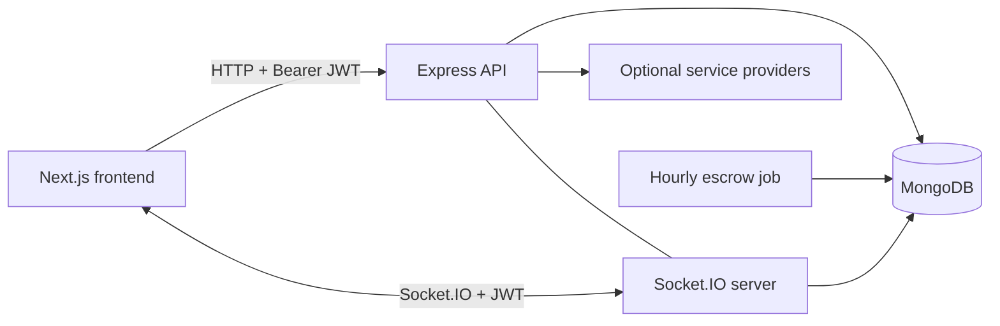

# Architecture

## Components

The frontend lives in `frontend/`; the Express API, models, and services live in `backend/src/`. The backend serves both REST endpoints and Socket.IO from the same HTTP server during local development.

## Request Flow

1. The frontend reads `NEXT_PUBLIC_API_URL` and sends API requests through `frontend/src/lib/api.ts`.
2. Authenticated requests attach the access token as `Authorization: Bearer <token>`. The API validates it in `backend/src/middleware/auth.middleware.ts` and loads the user from MongoDB.
3. API routes delegate to controllers, which use Mongoose models and services for business logic and integrations.
4. The frontend connects to `NEXT_PUBLIC_SOCKET_URL`; Socket.IO authenticates using the access token and joins a per-user room for messaging and notifications.

See [api.md](api.md) for the route inventory. The frontend API helper's built-in fallback URL is `http://localhost:5001/api`; for the local backend in this repository, set `NEXT_PUBLIC_API_URL=http://localhost:5000/api` as shown in `frontend/.env.example`.

## Runtime Services

- MongoDB is required. The backend connects before handling requests.
- Socket.IO and the hourly escrow auto-release job start when the backend runs as a regular Node.js server.
- When `VERCEL` is set, the backend skips creating its local HTTP server, Socket.IO server, and cron job. A deployment that needs real-time messaging or scheduled escrow processing must provide suitable persistent services separately.
- Razorpay, Cloudinary, Upstash Redis, Google OAuth, and SMTP are optional integrations. Configure only the providers needed for the features being exercised.

## Source Map

| Area | Location |
| --- | --- |
| Frontend routes and pages | `frontend/src/app/` |
| Shared frontend components | `frontend/src/components/` |
| Frontend API and Socket.IO clients | `frontend/src/lib/` |
| Backend application and middleware | `backend/src/index.ts`, `backend/src/middleware/` |
| REST route registration | `backend/src/routes/` |
| Business logic | `backend/src/controllers/`, `backend/src/services/` |
| MongoDB models | `backend/src/models/` |
| Socket.IO handlers and scheduled job | `backend/src/socket/`, `backend/src/jobs/` |